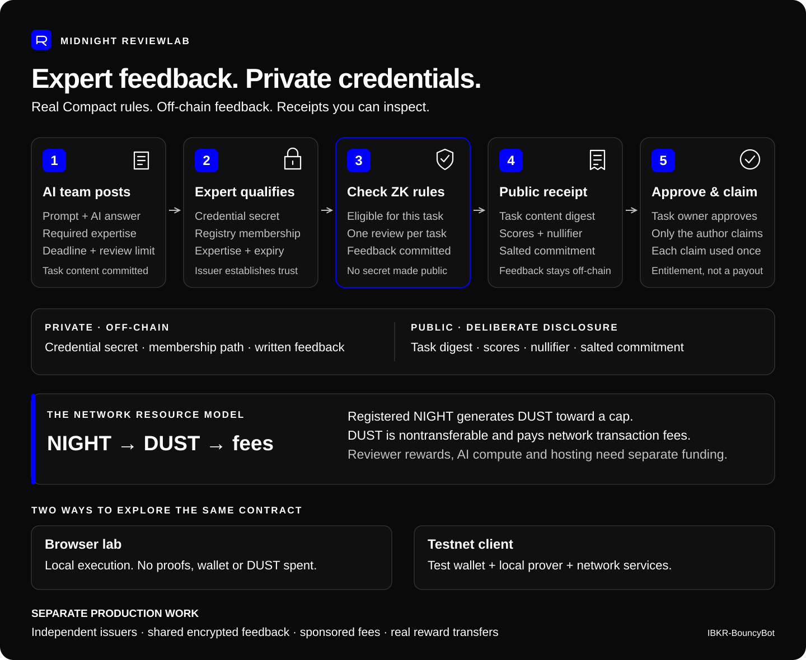
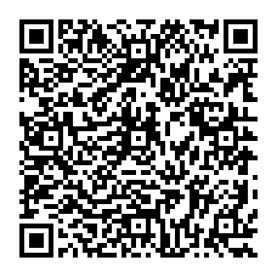

# Midnight ReviewLab

**Expert feedback for AI, with private credentials and verifiable review records.**

Post an evaluation task, review an AI answer, and keep a receipt. Midnight checks the reviewer's credential membership, expertise, validity and one-review-per-task rule without publishing the credential secret. The receipt binds the task content, scores and a salted commitment to the written feedback.

[Open ReviewLab](https://ibkr-bouncybot.github.io/Midnight-ReviewLab/) · [Source](https://github.com/IBKR-BouncyBot/Midnight-ReviewLab) · [How it works](docs/ARCHITECTURE.md) · [Privacy and trust](docs/SECURITY.md) · [Verification](docs/VERIFICATION.md)



## Choose your demo

The [landing page](https://ibkr-bouncybot.github.io/Midnight-ReviewLab/) offers two separate experiences built around the same Compact contract.

| Demo | What happens | What you need |
| --- | --- | --- |
| [Browser lab](https://ibkr-bouncybot.github.io/Midnight-ReviewLab/browser.html) | Explore tasks, credentials, feedback, receipts and approvals using actual generated Compact code and Midnight WebAssembly locally. No blockchain submission or DUST spending. | A modern browser. |
| [Testnet client](https://ibkr-bouncybot.github.io/Midnight-ReviewLab/network.html) | Connect Lace, deploy or join a contract, and let Lace prove, balance and submit transactions. | Browser with Lace, Preview test DUST, and Lace's **Run in this app (WASM)** setting. |

The testnet client defaults to public **Preview** and uses Lace's internal WASM prover for both contract and wallet/DUST proofs. No Docker or external proof server is part of this public-client setup. Lace pays its own transaction fees; sponsorship is not implemented and mainnet is disabled. Follow the [testnet setup guide](docs/TESTNET.md) and [Lace proving guide](docs/LACE-WASM.md). API 4 does not expose a verifiable proving-mode flag: the app requires your session confirmation and rejects reported prover URLs, but an omitted URL alone cannot distinguish internal proving from Lace's remote TEE mode.

Both the SDK workflow and the actual browser client have completed seven accepted transactions each on an isolated Midnight development chain using temporary, pre-funded test wallets. The browser test uses the official API-4 testkit adapter, not Lace.

A user-operated **Edge / Lace 2.5.1** test created a task on public Preview, accepted at block **1,627,842**. The [transaction check](docs/lace-preview-transaction.json) found both a contract proof and a DUST-spend proof. The [session record](docs/lace-preview-session.json) distinguishes the user's browser/wallet setup from the indexer evidence: extension traffic was not directly observed, and the chain does not attest where proving occurred. This tests one task-creation transaction, not the complete Lace marketplace lifecycle.

An independent **SDK run with official local WASM proving for both contract and DUST** completed the full seven-transaction lifecycle on public Preview. It also tested six rejection/recovery cases, including recovery after a lost submission response without resubmitting. Separately, all six contract proofs were generated inside a browser Web Worker, 38 unit tests and both eight-case browser suites passed, and nine actual encrypted-storage checks documented the provider's write-authorization limitation. See the [expanded verification and reproducible evidence](docs/VERIFICATION.md#expanded-automated-checks--6-november-2026). These SDK and worker tests do not substitute for operating the Lace extension.

Separately, a public Preview test wallet received [5,000 test NIGHT from the faucet](docs/public-preview-funding.json) and completed **eight accepted transactions**: DUST registration plus the seven-step marketplace lifecycle. That historical run used the Node wallet SDK and a local HTTP prover; the published page's receipt check used the official API-4 testkit adapter. The earlier review remains claimed and its task closed. See the [public evidence](docs/VERIFICATION.md#public-preview-status), download the [verified join file](docs/public-preview-marketplace.json), and follow the [join instructions](docs/TESTNET.md#inspect-the-recorded-public-deployment).

## Explore the browser lab

1. Browse the example evaluation tasks and inspect a prompt, AI answer and review rubric.
2. Create a demonstration expert credential for the required field. A private download can be re-imported into the same local session; refreshing starts a new registry.
3. Score an answer and submit written feedback. The native contract checks eligibility and rejects a second submission by the same credential for that task.
4. Keep the review receipt, inspect campaign results and explore approval and reward accounting.
5. Use the sponsorship calculator to explore how NIGHT-generated DUST could support transaction fees.

**A local contract check is not a generated zero-knowledge proof or a confirmed blockchain transaction.** The separate testnet client reports the actual proving, submission and confirmation stages. Website deployment is separate from contract deployment. The [verification report](docs/VERIFICATION.md) identifies which checks have been performed and their limits.

## What is private?

The credential secret is private input. ReviewLab uses a commitment and a task-specific nullifier so the contract can check eligibility and prevent reuse. Public records intentionally contain review identifiers, task information and verification data. Written feedback can identify its author if the author includes personal details.

The browser lab is a research prototype whose issuer, campaign owner and reviewer roles share one browser. Demonstration credentials are not independently verified professional qualifications. The testnet client separates transaction authorization through the wallet but does not establish professional credentials by itself. Public browser storage is not a shared marketplace backend, and reward records are not money transfers. See the [security boundaries](docs/SECURITY.md).

## Why NIGHT and DUST?

Registered NIGHT generates DUST toward a cap. DUST pays Midnight transaction fees and cannot be transferred like an ordinary token. A sponsor wallet can pay the fee for an action authorized by someone else, without obtaining that person's credential secret. This could let a marketplace cover contributors' blockchain fees from its own NIGHT reserve.

The browser lab's sponsorship screen is an illustrative planning tool. It does not read a live wallet, purchase NIGHT, generate DUST or pay model-inference costs. The testnet client uses wallet-paid DUST. A separate sponsor service remains production work. See [sponsorship design](docs/SPONSORSHIP.md) and Midnight's [official DUST sponsorship guide](https://docs.midnight.network/guides/dust-sponsorship).

## Build and run

Use Node.js 24 and Compact compiler 0.31.1. On Linux, install the official Compact tools and select compiler 0.31.1; Windows compilation uses WSL. The [development guide](docs/DEVELOPMENT.md) explains the workflow.

```sh
npm ci --ignore-scripts
npm run compile
npm test
npm run build
```

Run `npm run dev` to serve `dist/` locally, then choose the browser or testnet demo. Both bundles use real generated contract code and native WebAssembly. Missing generated output must fail the build. A frontend build does not configure Lace or fund a wallet. Local HTTP provers remain available only for the separate developer proof and isolated-network harnesses.

The GitHub Actions workflow repeats compilation, tests and the production build, then publishes `dist/` with GitHub Pages. It never uploads wallet secrets or private credential files. See [deployment](docs/DEPLOYMENT.md).

## From prototype to shared service

A production marketplace needs independent credential issuers, shared encrypted feedback storage, a reviewed production deployment, a sponsor service with usage limits, actual reward settlement, and an operational privacy review. The [architecture guide](docs/ARCHITECTURE.md) describes these boundaries. Zero-knowledge privacy is not exclusive to Midnight; this project deliberately uses Midnight's Compact contract model and NIGHT-generated DUST fee resource.

## Buy me a coffee

If ReviewLab has been useful, you can support IBKR-BouncyBot with a little NIGHT or ADA. It's completely optional.

**NIGHT or ADA · Cardano mainnet**

Scan the QR code or copy the address below. The [support section](https://ibkr-bouncybot.github.io/Midnight-ReviewLab/#support) also has a copy button. This support address is separate from the application's testnet wallets.



```text
addr1q85w2v474ywzx868s69pghygek3vrhxm69e7c6ysuf28qhv8kmj5wd059grxl82f8h5mtyzl87cvqj8ldv2e0las7tnsdej9ax
```

## License

Project-owned material is available under [PolyForm Noncommercial 1.0.0](LICENSE). Commercial use requires separate written permission from IBKR-BouncyBot. Third-party packages retain their own licenses. See [NOTICE.md](NOTICE.md).
